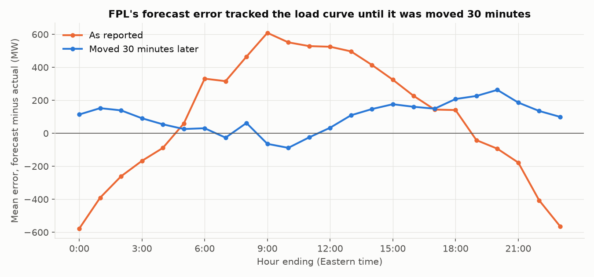
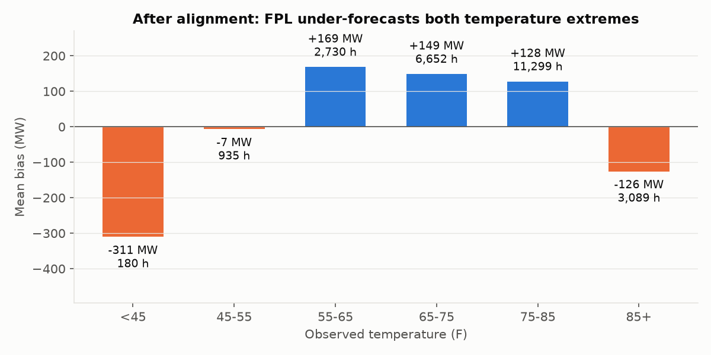

# FPL's public day-ahead load forecast: alignment and a fair benchmark

Florida Power & Light publishes its hourly load and its own day-ahead load forecast through the EIA. I checked how clean that data is, scored FPL's forecast by slice, measured how much observed weather flatters a backtest, and compared a simple honest model with FPL's forecast on the same hours.

**Data:** EIA-930 (FPL demand and day-ahead forecast); observed temperatures at 7 airports in FPL's territory (Iowa State ASOS archive); GFS temperature forecasts made about a day ahead (Open-Meteo Previous Runs). Jan 2024 to Nov 2026, 25,032 hours, all in UTC, hour-ending.

**Notebook:** [`fpl_load.ipynb`](fpl_load.ipynb) · **Code:** [`../src/fpl.py`](../src/fpl.py), download in [`../src/fpl_data.py`](../src/fpl_data.py) · **Tests:** [`../tests/test_fpl.py`](../tests/test_fpl.py)

## Findings

### 1. The biggest "forecast error" was a 30-minute convention difference

As published, FPL's forecast scores 3.21% MAPE, and its bias follows the shape of the load curve: too high while load rises, too low while it falls. That pattern points to timing, not forecasting skill.



I tested it step by step:

| Version | MAPE |
|---|---|
| As published | 3.21% |
| Moved 1 hour later | 3.70% |
| Moved 1 hour earlier | 7.12% |
| **Moved 30 minutes later** | **2.40%** |
| Moved 30 minutes earlier (control) | 5.00% |
| Smoothed, no shift (control) | 3.18% |

- A one-hour offset (the daylight-saving suspect) was wrong: the unshifted forecast beats both one-hour shifts.
- The lopsided result (an hour later costs little, an hour earlier doubles the error) pointed to a lead of *less* than an hour.
- Moving the forecast 30 minutes later removed the ramp-shaped bias and cut MAPE by a quarter.
- The two controls show the gain comes from the timing, not from the averaging that moving by half an hour involves.

The likely explanation is a definition difference, for example actual load averaged over the hour against a forecast value at the hour mark. Only FPL or EIA could confirm which. It's a data convention, not a judgment of FPL's forecast.

### 2. Aligned, FPL's forecast is excellent, with a pattern at the extremes

- **2.40% MAPE over 2024-2026,** best overnight and through the morning (about 1.5-1.8%), hardest from mid-afternoon into the evening (3.1-3.3%).
- **It under-forecasts both temperature extremes and over-forecasts mild weather:**



That's the pattern of a temperature response slightly too flat at the tails. The coldest band is only 180 hours, mostly one cold snap, so it's a strong hint rather than proof.

### 3. The public data needed an audit first

- 49 missing load hours.
- 5 one-hour load glitches, including a **32,218 MW spike that looks like a record** but sits between hours near 12,300 MW, and a 39 MW drop.
- 8 bad airport readings (Sarasota at −73 °F, Fort Myers at 0 °F), and one station (West Palm Beach) with no observations at all, dropped from both the observed and forecast averages.
- After cleaning, **FPL's highest hours were August 2026 afternoons (about 29,960 MW),** not the February 2026 cold snap.
- **Day-ahead temperature forecasts run cool** at every station, by 0.7 °F (Pensacola) to 2.7 °F (Miami), and most at night (about −2.3 °F vs. −0.9 °F mid-afternoon). A bias correction should depend on the hour.

### 4. Observed weather flatters a backtest, and a naive pipeline is worse

The same simple model (one Ridge regression per local hour: temperature hinges, day of week, holidays, trend, and load lags of 48 and 168 hours), trained on 2024-2025 and tested on 2026:

| Run | Trained on | Tested with | 2026 MAPE |
|---|---|---|---|
| A, flattering | observed temps | observed temps | 3.87% |
| C, honest | forecast temps | forecast temps | 4.21% (+9%) |
| B, naive pipeline | observed temps | forecast temps | 5.34% (+38%) |

- **The flattering backtest understates error by about 9%.** In my [ERCOT project](https://github.com/Lolale3/honest-load-forecast) it was 19%; Florida's weather is milder and easier to forecast a day ahead.
- **The naive pipeline is the real risk.** Trained on observed temperatures, the model never learns that forecasts run about 2 °F cool, so it under-predicts cooling load every day. Train on what you'll actually have at forecast time.

### 5. A fair benchmark against FPL

Same 7,446 hours of 2026, same rules:

| Forecast | MAPE | Bias | Skill vs. same hour last week |
|---|---|---|---|
| FPL day-ahead (aligned) | **2.53%** | +85 MW | 92% |
| Honest model (C) | 4.19% | +0.5 MW | 81% |
| Same hour last week | 9.55% | −63 MW | 0% |

FPL's forecast is clearly better. Even with perfect weather (run A), the simple model trails it, so the gap is mostly model richness, not weather inputs. FPL likely uses more stations, humidity and cloud cover, several weather providers, and updates right up to submission. Cheap next steps for my model: humidity (heat index) and blending a second weather model.

## Limitations

- The 30-minute explanation is tested, but the exact convention behind it isn't confirmed; that would need FPL or EIA.
- Temperatures are a simple average of six airports, not weighted by where load is.
- One weather model (GFS) for the temperature forecasts.
- The coldest-band result rests on 180 hours.

## Reproduce

```bash
pip install -r ../requirements.txt
EIA_API_KEY=your_key python -m src.fpl_data     # from the repo root; writes data/fpl/fpl_hourly.parquet
jupyter notebook fpl_load.ipynb
```

Get a free EIA API key at [eia.gov/opendata](https://www.eia.gov/opendata/). Keep it in an environment variable or Colab Secrets, never in code. Data credits are in [`../data/README.md`](../data/README.md).
