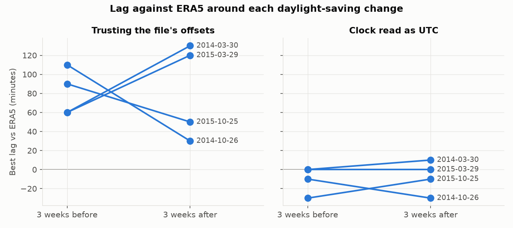
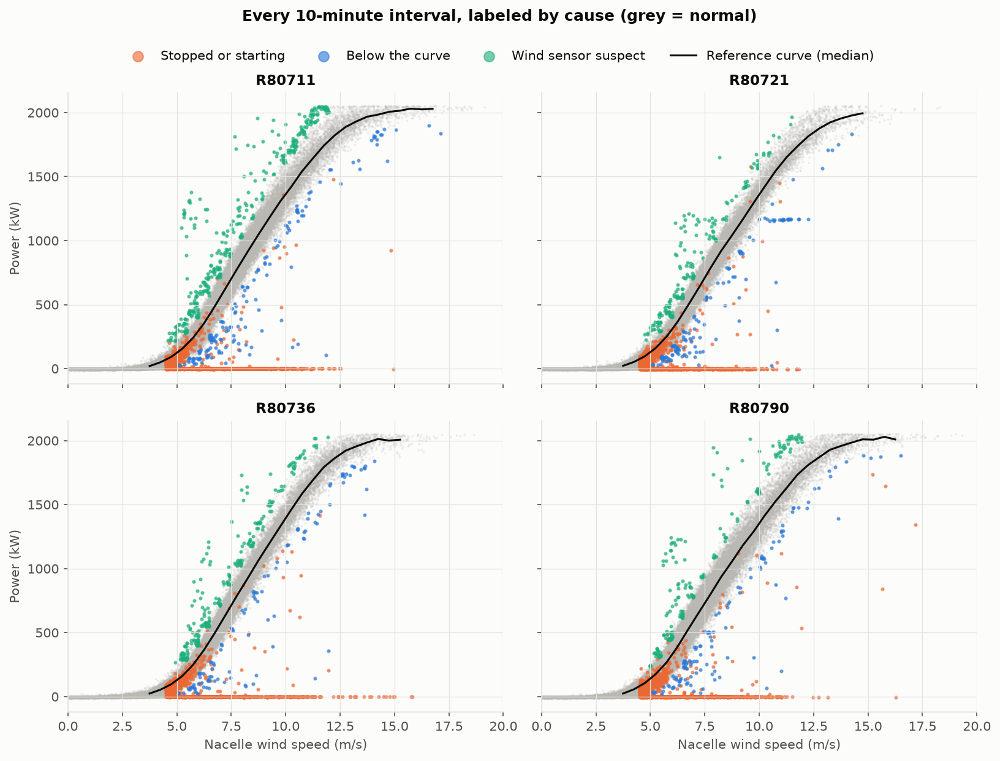
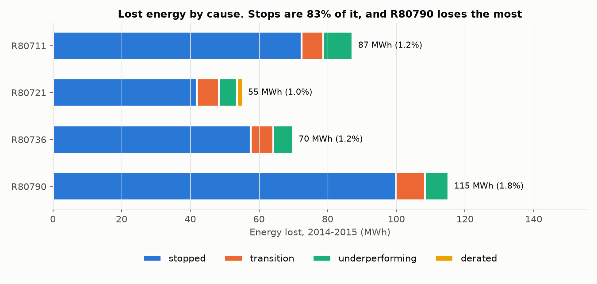
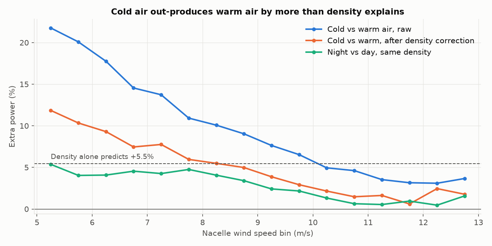

# Wind turbine SCADA audit

Two years of 10-minute SCADA data from four wind turbines: what was wrong with the file, what time it really was, why the turbines fell off their power curve, and what each cause cost.

**Data:** La Haute Borne wind farm, France, published by ENGIE. 4 × Senvion MM82 (2,050 kW, 80 m hub, 82 m rotor), 2014–2015, 420,480 rows. ERA5 and MERRA-2 reanalysis serve as outside references.

**Notebook:** [`scada_audit.ipynb`](scada_audit.ipynb) · **Code:** [`../src/scada.py`](../src/scada.py) · **Tests:** [`../tests/test_scada.py`](../tests/test_scada.py)

## Findings

### 1. A perfect row count hid broken timestamps

The file has exactly 4 turbines × 144 intervals × 730 days = 420,480 rows, so it looks complete. It isn't:

- The night the clocks went forward, 03:00–03:50 appears **twice** with different readings: 6 extra rows.
- The night they went back, one of the two real 02:00–02:50 hours is **missing**: 6 rows short.
- The two cancel out, so the total still matched.

Other problems that `isna()` doesn't catch: a −273.2 °C sentinel temperature (absolute zero) on 34 rows, blade pitch from −121° to 263° on 43 rows, and 2,569 fully blank rows.

### 2. The clock was wrong all year, not just on two nights

ERA5 has no daylight saving. So I found the time shift that best lines up farm wind with ERA5 wind, 3 weeks before and 3 weeks after each clock change. I wrote down the prediction first: if the offsets were wrong, the lag would jump by about an hour, in the same direction, at every change.



| Clock change | Jump, trusting the file's offsets | Jump, clock read as UTC |
|---|---|---|
| Mar 2014 | +70 min | +10 |
| Oct 2014 | −80 | −20 |
| Mar 2015 | +60 | 0 |
| Oct 2015 | −40 | +20 |

The logger ran on **UTC**, and the export stamped those times with **Paris offsets**. Read with those offsets, winter rows land an hour early in UTC and summer rows two hours early. MERRA-2, a second reanalysis, shows the same pattern (+90, −120, +70, −30 min). This is strong evidence, not proof: only the logger's documentation could confirm it.

It doesn't affect anything that compares a turbine with itself, but it shifts every row as soon as SCADA is joined to weather, forecasts or prices.

### 3. Cleaning, and proving it worked

`load_tidy` drops blank rows and both copies of each duplicated stamp, and turns impossible temperature and pitch values into NaN while keeping the row. `check` counts failures for uniqueness, validity, the 10-minute grid and completeness. The checks **fail on the raw file** (48 duplicates, 43 bad pitch, 34 bad temperatures) and **pass on the cleaned one**: 417,815 rows kept, 98.8–99.6% complete per turbine.

### 4. Every off-curve point gets a cause

Each 10-minute interval gets one label. The rules use the turbine's published specs and each turbine's own learned behavior, not numbers read off this farm, so the same code can run elsewhere by changing `SPEC`.

| Label | Rule (first match wins) |
|---|---|
| stopped | power ≤ 1% of rated, blades turned > 20° from running pitch |
| transition | next to a stopped interval: a start or stop inside the 10 minutes |
| derated | below the curve and pitched while below rated wind, 3+ intervals in a row |
| underperforming | below the curve by 3 spreads, blades at running pitch |
| wind sensor suspect | **above** the curve by 3 spreads: too much power for the wind reading |
| normal / no usable wind / unknown | everything else |

"The curve" is each turbine's median power per 0.5 m/s bin. "Spread" is the scaled median absolute deviation, so bad points don't bend the reference.



Three known events check the rules:

- **A stop at 15 m/s (14 Sep 2015):** one interval averages running and stopped (half power, pitch 23°). It's labeled a transition, and so is the restart.
- **An ice stop, then a derate (2 Jan 2015):** below freezing overnight, three turbines stopped, and their anemometers read 2–4 m/s while their neighbor read 5–12. After the thaw, R80721 ran capped near 1,160 kW with pitch at 5–8° while the others ran at 0–2°. That cost about 2.9 MWh in 4 hours. Pitch shows it was a deliberate cap; *why* isn't in the data.
- **All four anemometers ice at once (23 Feb 2015):** all four read 5–7 m/s while ERA5 held at about 11.5 m/s and the turbines made 700–1,250 kW. Comparing neighbors can't catch this, because they all failed together; it took an outside reference. "Wind sensor suspect" rows have a median temperature of 1.3 °C (normal rows: 11.9 °C). 76% are at or below 3 °C, against 7% of normal rows.

### 5. Some labels are robust, some aren't

| Label | k = 2 | k = 3 | k = 4 |
|---|---|---|---|
| stopped | 3,229 | 3,229 | 3,229 |
| transition | 2,852 | 2,852 | 2,852 |
| derated | 24 | 21 | 19 |
| underperforming | 3,880 | 491 | 147 |
| wind sensor suspect | 6,801 | 941 | 332 |

Labels based on what the turbine *did* (pitch and power) barely move when the threshold changes. Labels based on distance from the curve swing 20–26×, so I report those with the threshold stated.

### 6. Stops are 83% of the lost energy



- **327.7 MWh lost** over two years, **1.3%** of potential energy. Stops account for 272.1 MWh of that.
- **R80790 lost 1.8%**, nearly twice the rate of the other three. It's the first turbine to investigate.
- The derate from finding 4 made a good story but cost only 1.6 MWh in total.
- Even at the loosest threshold, underperformance (120 MWh) is less than half of what stops cost, so "stops dominate" holds whichever threshold I pick.
- "Normal" points are excluded from losses. They scatter on both sides of the curve, and counting only the shortfalls would turn noise into a fake loss of about 1,000 MWh.

### 7. Same wind, different power: density explains only part of it



- Dense (cold) air was 5.5% denser than thin (warm) air, so physics predicts about 5.5% more power at the same wind speed.
- At 5–6 m/s, cold-air turbines actually made **about 20% more**. After the IEC density correction, about **10–12%** is still left.
- With density held fixed, **nights out-produced days by 3–6%** at 5–9 m/s in every density band. That fits atmospheric stability: calm nights have stronger wind shear across the rotor, so the hub anemometer understates what the rotor sees.
- About 5% is still unexplained. Separating it would need a met mast that measures wind at several heights.

## Limitations

- No alarm or status codes and no curtailment setpoints. Where real fleet data has those, they should come before these rules, which are the fallback for sensor-only data.
- Wake losses, and blade icing slow enough to stay inside the normal band, are invisible here, so the true loss is somewhat higher than 1.3%.
- Pressure for the density calculation comes from ERA5, not a site barometer.
- The rules are designed to work on other farms, but they've only been run on this one. The real test is another dataset, unchanged (for example, Kelmarsh in the UK).

## Reproduce

```bash
pip install -r ../requirements.txt
jupyter notebook scada_audit.ipynb      # downloads the data (~36 MB) on first run
pytest ../tests                          # runs on synthetic data, no download needed
```

Data credits are in [`../data/README.md`](../data/README.md).
