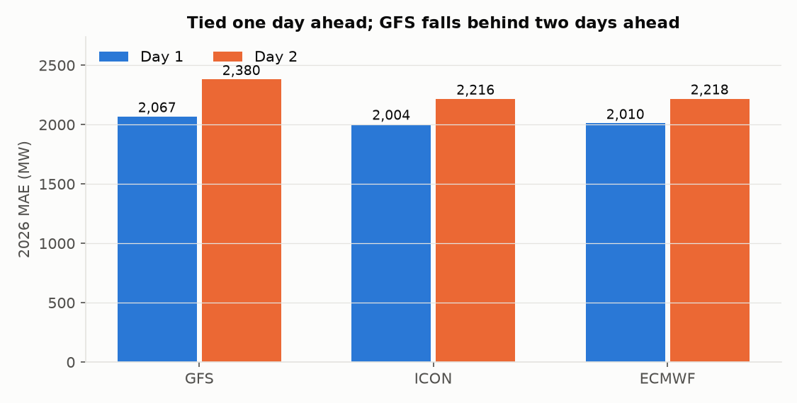
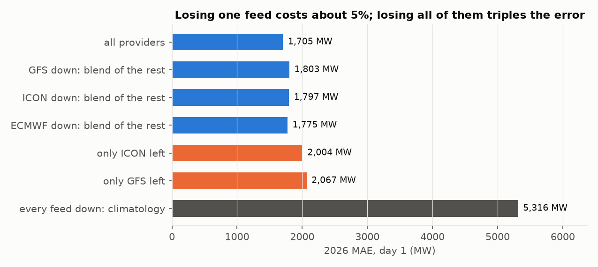
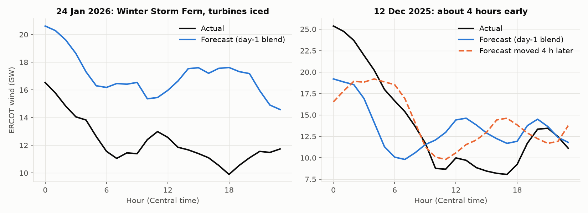

# Which weather models earn their place in a wind power forecast?

If you buy wind forecasts from several weather providers, which ones are worth keeping, what does a blend gain, and what happens when a feed fails? I answered this for ERCOT's whole wind fleet, using free public weather models as stand-ins for commercial providers, which mostly post-process these same models.

**Data:** ERCOT hourly wind generation (EIA-930); archived 100 m wind forecasts made about 1 and 2 days ahead by GFS, ICON and ECMWF (Open-Meteo Previous Runs API) at 9 points across West Texas, the Panhandle and the South Texas coast. March 2024 to November 2026, all in UTC, hour-ending.

**Method:** every provider gets the *same* LightGBM model (its winds at the 9 points, hour of day, month, and a monotonic constraint so more wind always means more power), so score differences come from the weather, not the modeling. Trained before 2026 and scored on 7,512 hours of 2026. Blend weights are fit on a separate validation half-year (Jul-Dec 2025). Differences are tested with a weekly block bootstrap, because forecast errors come in streaks.

| Notebook | What it covers |
|---|---|
| [`0_physics.ipynb`](0_physics.ipynb) | Why hub height matters, and where wind errors hurt |
| [`1_data_audit.ipynb`](1_data_audit.ipynb) | Coverage, gaps, fleet growth, and a feed that was two models in one |
| [`2_provider_benchmark.ipynb`](2_provider_benchmark.ipynb) | Each provider alone: by lead time, season, time of day, wind regime |
| [`3_blending_and_fallbacks.ipynb`](3_blending_and_fallbacks.ipynb) | Blends, each provider's added value, and what happens when feeds fail |
| [`4_worst_days.ipynb`](4_worst_days.ipynb) | The 10 worst days and why they went wrong; write-up in [`worst_days_memo.md`](worst_days_memo.md) |

Code: [`../src/wind.py`](../src/wind.py), download in [`../src/wind_data.py`](../src/wind_data.py). Tests: [`../tests/test_wind.py`](../tests/test_wind.py).

## Findings

### 1. One day ahead the providers are tied; two days ahead they separate



| Provider | Day 1 MAE | Day 2 MAE | Day 2 worse by |
|---|---|---|---|
| ICON | 2,004 MW (7.7%) | 2,216 MW (8.5%) | 11% |
| ECMWF | 2,010 MW (7.7%) | 2,218 MW (8.5%) | 10% |
| GFS | 2,067 MW (7.9%) | 2,380 MW (9.1%) | 15% |

(Percentages are nMAE, against a fixed capacity reference of 26,177 MW from the training years.)

- **Day 1:** ICON is nominally best, but no provider is clearly worse; every bootstrap interval includes zero.
- **Day 2:** GFS is clearly worse, by 166 MW (95% interval: 43 to 285 MW).
- All three beat climatology by about 82% and 48-hour persistence by about 89% (skill on squared error).
- Errors are largest at night and in the evening (8.0-8.9% nMAE) and smallest in the afternoon (6.6-6.7%), and largest for low and mid-curve winds, where the power curve is steep.

GEM was part of an earlier run and was also tied on day 1. The archive API was timing out when I pulled it again, so it isn't in these final results.

### 2. A simple equal blend beats every single provider by 15%

| Day 1, 2026 | MAE | vs. best single provider (95% interval) |
|---|---|---|
| ICON alone (best single) | 2,004 MW | |
| **Equal blend of all three** | **1,705 MW** | **−298 MW (−360 to −236)** |
| Inverse-MSE weights | 1,705 MW | −298 MW |
| Fitted (constrained) weights | 1,711 MW | −293 MW |

- **Fitted weights add nothing** over equal weights. With three similar providers, estimating weights is a risk without a reward.
- **Two days ahead, the blend (1,903 MW, 7.27%) still beats the best day-1 single provider (2,004 MW, 7.65%).** Blending is worth more than a day of lead time.
- The providers' errors are only moderately correlated (0.49-0.62; ICON and ECMWF most alike), which is why the blend helps.

### 3. Every provider earns its place

Removing any one provider from the blend costs 70-98 MW on day 1 and 84-117 MW on day 2, and every interval is clear of zero. None is redundant.



If one feed fails, the blend of the other two costs about 5% more error. With only one provider left, it's 18-21% more. If every feed fails, falling back to climatology triples the error, but it still delivers a forecast.

### 4. Hub-height wind is worth about a day of lead time

Same model (pure GFS), 10 m surface wind instead of 100 m:

| Input (2026, day 1) | nMAE |
|---|---|
| GFS 100 m | 7.8% |
| GFS 10 m | 9.1% (17% worse; clearly worse, +271 to +424 MW) |
| GFS 100 m, day 2 | 9.0% |

The penalty was largest at night (10.5% vs. 8.5%) and in winter (10.6% vs. 8.5%), the stable conditions where surface and hub-height winds come apart. This matches the [physics notebook](0_physics.ipynb), where extrapolating from 10 m with a textbook shear exponent lost 38% of a turbine's energy. *These numbers come from my run with the 10 m download (`python -m src.wind_data --surface`); the default table doesn't include those columns.*

### 5. One feed was two models in one

The "GFS seamless" 10 m feed differed by 1.31 m/s between its day-1 and day-2 forecasts, steadily every quarter, and its two leads correlated at only 0.87 (about 0.95 for the others). It was blending a different model at short leads near the surface. Comparing it by lead time would have compared two different models, so the height test uses pure GFS. At 100 m, all three feeds behave like single models.

### 6. The worst days are shared misses that blending can't fix

On 9 of the 10 worst days, all three providers missed in the same direction. The largest group was windy days that every model forecast as ordinary. One was ice: on 24 Jan 2026 (Winter Storm Fern), ERCOT reported about 13.5 GW of wind capacity unavailable because of icing. Details in [`worst_days_memo.md`](worst_days_memo.md).



## Recommendation

Keep all three providers in an equal-weight blend; each adds value, and fitted weights don't help. If one feed fails, blend the other two. If all fail, deliver climatology rather than nothing. Improve the bad days with updates closer to delivery, an icing adjustment, and curtailment data, not with more global models, since they miss together.

## Limitations

- Public models stand in for commercial providers; nine points stand in for a fleet of hundreds of farms. Differences between providers would likely be larger at individual wind farms.
- About 10 months of test data. Seasonal results rest on one winter and one summer.
- No curtailment or outage data, so operations and weather can't be fully separated.
- A small steady under-forecast (2-4%), consistent with fleet growth after training. A recent-bias correction removes the bias but barely changes MAE.

## Reproduce

```bash
pip install -r ../requirements.txt
EIA_API_KEY=your_key python -m src.wind_data              # from the repo root; add --surface for GEM and 10 m
jupyter notebook 2_provider_benchmark.ipynb               # then 3 and 4, which use its predictions
```

The download makes one archive request per model, point and year, retrying on timeouts; raw responses are cached in `data/wind/raw/`, so reruns are fast. Data credits are in [`../data/README.md`](../data/README.md).
